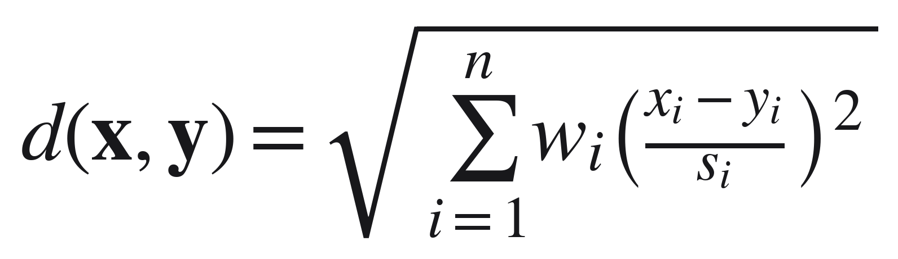
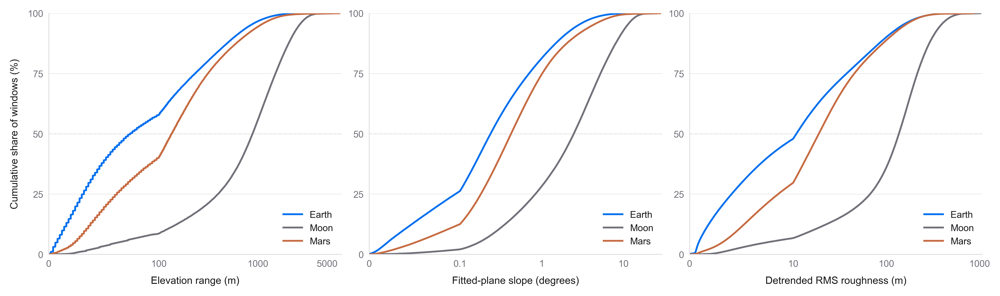
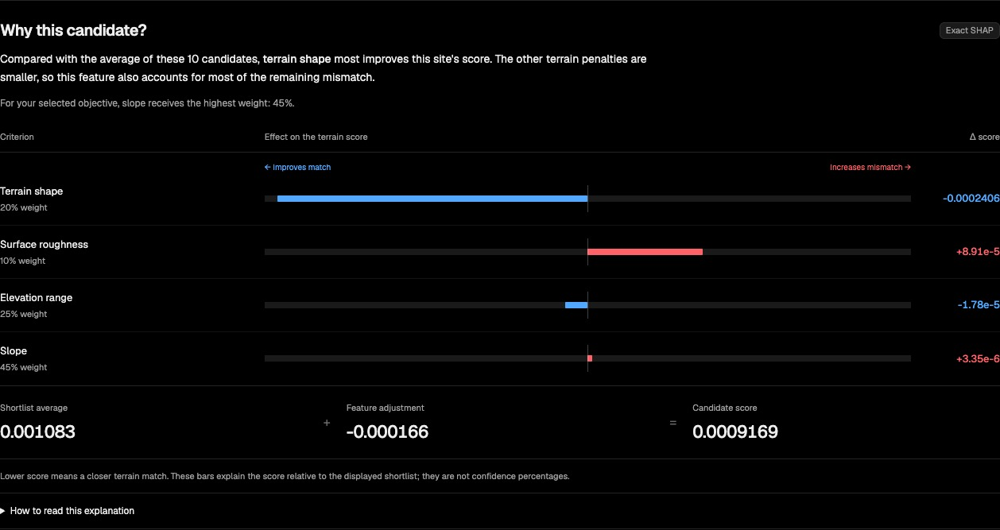

# Terrain data and matching

Data analysis and methods for finding Earth locations with terrain similar to a selected place on the Moon or Mars.

**[Try the website](https://nasa.aezakmi.org) · [Presentation (PDF)](presentation/aezakmi-project.pdf) · [Method](docs/MODEL_CARD.md) · [Sources and data counts](docs/DATA_SOURCES.md) · [English charts](presentation/README.md)**

## What the website compares

Each location is represented by **25 heights over a 10 × 10 km window**. We compare four properties:

| Criterion | What it captures |
|---|---|
| Terrain profile | The arrangement of high and low ground, after aligning the windows. |
| Elevation range | The difference between the highest and lowest samples. |
| Regional slope | The inclination of a plane fitted to the window. |
| Roughness | Height variation left after removing that plane. |

The search checks **1,356,072 eligible Earth windows**. The testing task changes the importance of each criterion. For a rover, slope gets 45%, roughness 25%, terrain profile 20% and elevation range 10%.

## The matching formula



In plain words: **measure the differences, divide by reference scales, apply task weights, and combine them**. Smaller distance means a closer terrain match. The API ranks by the squared distance, which gives the same order.

We chose this form so metres and degrees can be compared, task priorities stay explicit, and large mismatches receive a larger penalty. The weights and scales are design choices; they were not learned from successful rover tests. [Definitions and an example](docs/MODEL_CARD.md).

## What the data showed



We analysed **all 3,183,884 eligible windows** in the delivered Earth, Moon and Mars atlas. Median elevation range was **74 m on Earth, 134 m on Mars and 882 m on the Moon**. These are window statistics at our chosen scale.

The distributions differ, but individual regions can still match. Some features are strongly related: elevation range and roughness have Spearman correlations of about **0.95 on Earth** and **0.94 on Mars**. We therefore show how the score was formed rather than treating each criterion as independent evidence. [Charts, CSVs and reproduction](presentation/README.md).

## Explain a recommendation



Exact SHAP shows how each criterion changes a candidate's mismatch relative to the average of the displayed shortlist. Blue means less mismatch; red means more. The baseline and four contributions add back to the score.

Temperature and other environmental conditions have their own passport. They do not affect the terrain ranking.

## What we trained

We also trained **MiniBatchKMeans on 150,000 Mars terrain vectors** and tested 6, 10 and 14 clusters. Ten types were kept as a useful level of detail for the prototype. Each type has a fixed set of Earth candidates.

That experiment is saved here with its model, global map and inference code. The current website uses the four-criterion search described above. [Training, results and limitations](docs/EXPERIMENTAL_MODEL.md).

## Work with the repository

| Folder | Contents |
|---|---|
| `docs/` | Method, data sources, audited counts and validation. |
| `presentation/` | English PNG charts, supporting CSVs and saved search examples. |
| `models/`, `artifacts/mars/` | Trained clustering model, type map and candidate catalogue. |
| `training/`, `runtime/` | Experimental training and inference code. |
| `artifacts/environment/` | Country polygons and the Mars climate snapshot. |
| `scripts/` | Auditing, chart export and artifact synchronisation. |

```bash
# Keep api/, web/ and ml/ next to each other. Run from ml/.
python3 scripts/audit_production.py --api ../api
python3 -m unittest discover -s tests -v
```

The live search implementation is in [api](https://github.com/naza-aezakmi/api); the interface is in [web](https://github.com/naza-aezakmi/web). Research uses Python, NumPy, pandas, SciPy, scikit-learn and Matplotlib.

[Validation](docs/VALIDATION.md) checks the implementation. Field accuracy and rover passability still need independent expert and field data.
