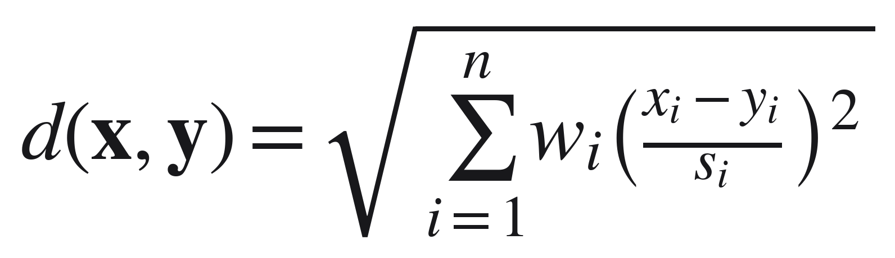

# How terrain matching works

The search helps teams shortlist Earth locations for a field test. It compares regional terrain around a selected Moon or Mars coordinate. The test objective decides which properties matter most.

**[Website](https://nasa.aezakmi.org) · [Sources](DATA_SOURCES.md) · [Validation](VALIDATION.md) · [Separate KMeans experiment](EXPERIMENTAL_MODEL.md)**

## From a click to a terrain window

A click resolves to an atlas cell. Its window contains **5 × 5 height samples**, spaced **2.5 km** apart: **10 km between the outer samples**. The response includes the cell centre actually used. Clicks resolving to the same cell and weights give the same result.

Heights are stored in 2 m increments. That is a storage setting, not a claim of 2 m DEM accuracy.

## Four criteria

| Criterion | Calculation | Unit |
|---|---|---|
| Terrain profile | Subtract each window's own mean height. Try rotations of 0°, 90°, 180° and 270°. Keep the lowest root mean squared difference between the 25 aligned heights. | m |
| Elevation range | Highest sample minus lowest sample. Compare the Earth and planetary values. | m |
| Regional slope | Fit a plane to the 25 heights by least squares. Compare the inclination angles of the two planes. | degrees |
| Residual roughness | Calculate RMS height residuals after removing the fitted plane. Compare the two values. | m |

Centring removes differences in absolute altitude. A valley on a high plateau can therefore match a lower valley. Alignment permits quarter-turns; it does not stretch terrain or search continuous rotation angles.

Regional slope describes overall tilt. It is not the steepest slope or the mean of local slopes. A symmetrical crater can have little overall tilt and steep walls. Roughness describes kilometre-scale landforms, not rocks or wheel contact.

[terrainStats in relief-worker.js](https://github.com/naza-aezakmi/api/blob/main/terrain-atlas/relief-worker.js) implements these measurements. The plane uses all 25 samples; the sum of squared x coordinates, and likewise y coordinates, is 312,500,000 m².

## One short formula

- **x and y** represent the planetary and Earth terrain being compared.
- **i** is one of the four criteria.
- **wᵢ** is its task weight.
- **sᵢ** is a reference scale that makes the differences comparable.

For the profile criterion, the difference is the aligned profile RMSE. For the other three, it is the difference between Earth and planetary measurements.

| Criterion | Reference scale |
|---|---:|
| Profile RMSE | 100 m |
| Elevation range | 150 m |
| Regional slope | 2° |
| Roughness | 50 m |

The API score is **D = d²**. Taking the square root would not change the ranking. This is weighted, normalised Euclidean matching, with profile alignment before scoring. Cosine distance is not used.

We chose this form because criteria have different units, tasks need different priorities, and squaring penalises large mismatches more strongly. The additive score also allows exact feature explanations.

Weights and scales are design settings, not learned safety limits, standard deviations or NASA recommendations. Correlated criteria can describe overlapping terrain properties; four low penalties are not four independent confirmations.

## How the task changes the weights

Weights are non-negative and sum to one.

| Task | Profile | Range | Slope | Roughness |
|---|---:|---:|---:|---:|
| Rover testing | 20% | 10% | 45% | 25% |
| Astronaut field training | 20% | 25% | 45% | 10% |
| Landing sensor testing | 45% | 25% | 20% | 10% |
| Excavation site layout | 10% | 20% | 45% | 25% |
| Geology and sampling practice | 45% | 25% | 10% | 20% |

For example, profile RMSE of 50 m, range difference of 75 m, slope difference of 1° and roughness difference of 25 m each give a normalised difference of 0.5. The score is **D = 0.25**, or **d = 0.5**. With rover weights, increasing only the slope difference to 2° raises D to **0.5875**.

The optional language-model service turns a custom task description into an order of these same criteria. It does not generate sites or terrain measurements. Preset tasks need no language model. If the custom service is unavailable, the default order is profile, range, slope, roughness. The response reports `prioritySource`.

## How ten candidates are selected

The delivered Earth atlas stores **1,400,048 land windows**. A regional coastline and lake screen leaves **1,356,072 eligible centres**.

The worker keeps separate shortlists for the United States and other regions. When enough candidates exist, three positions are reserved for the US and seven for other regions; unused positions can be filled from the other group. The combined list is sorted by score.

The returned ten are therefore not necessarily the ten smallest scores worldwide. There is currently no minimum separation rule between candidates. Country labels refer to the window centre.

## How to read SHAP

Each criterion contributes one weighted penalty to D. For this additive score, its exact interventional SHAP value is:

**candidate's criterion penalty − average criterion penalty in the returned shortlist**

The baseline is the average score of that shortlist. **Baseline + four SHAP values = the candidate's score.**

| Bar | Meaning |
|---|---|
| Blue / negative | Less mismatch than the shortlist average for this criterion. |
| Red / positive | More mismatch than the shortlist average for this criterion. |

Changing the objective or shortlist changes the baseline. These bars explain the terrain score; the water mask and geographic allocation are separate selection rules. They do not express confidence, causality or global feature importance.

The calculation is analytical and needs no approximate explainer or separate model. [Code](https://github.com/naza-aezakmi/api/blob/main/app/terrain_explain.py) and [checks against all 24 feature permutations](https://github.com/naza-aezakmi/api/blob/main/tests/test_terrain_explain.py).

## Other information in a result

Height matrices show the 25 samples and their aligned differences. Pearson correlation describes the height pattern; it can be high even when height amplitudes differ. MAE and maximum error are additional summaries, not extra ranking terms.

Temperature and atmospheric conditions appear separately. Earth climate averages, the Mars model snapshot and Moon surface temperatures have different periods and physical meanings, so we do not combine them into the terrain score.

## What the result can support

The method provides a reproducible regional shortlist. We have tested the calculations, but have not measured precision@10 against independent expert-labelled sites or validated rover passability in the field.

Next steps are expert review by task, hard negative examples, sensitivity to window size and position, and finer DEM comparison of finalists at a common scale. A rover-specific assessment also needs obstacle size, soil mechanics and vehicle dimensions.
