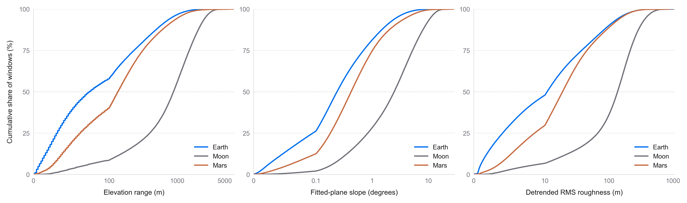
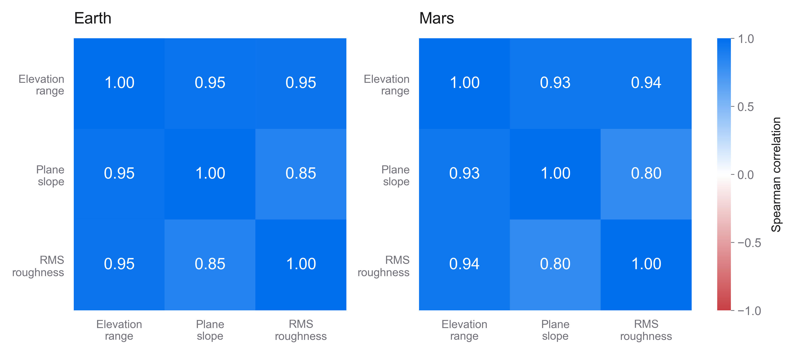
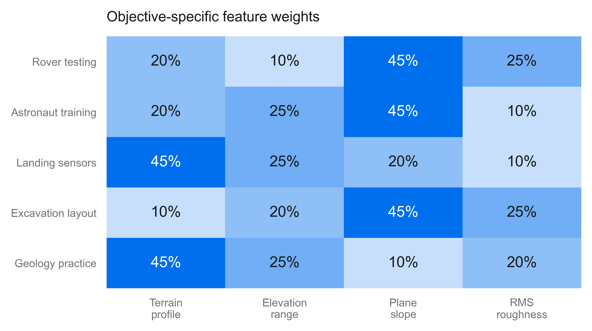
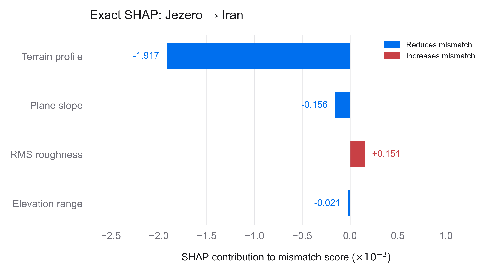

# English charts

Standalone PNG charts on a light background, ready to place in a presentation.

**[Team presentation (PDF)](aezakmi-project.pdf) · [Download all ten PNGs](charts_en/charts_english_png.zip) · [Source CSVs](data) · [Matching method](../docs/MODEL_CARD.md) · [Data sources](../docs/DATA_SOURCES.md)**

## EDA: what the terrain data showed



The EDA covers **all 3,183,884 eligible windows** in the delivered atlas: Earth 1,356,072, Mars 1,446,856 and Moon 380,956. Features use the same `terrainStats` function as the API.

The median elevation ranges are **74 m, 134 m and 882 m** for Earth, Mars and Moon. The curves show the share of windows at or below each value; 50% marks the median. Their shapes differ, while individual locations can still match.

Each curve is drawn from 501 full-data quantiles. Only the extreme tail is clipped in the plot; the CSV includes the full range. The x axis uses a symmetric logarithmic scale. These are window distributions, not exact area fractions.



Range and roughness are strongly related: Spearman ρ is about **0.95 on Earth** and **0.94 on Mars**. Several matching criteria can describe overlapping terrain properties. The Moon matrix is included separately.

## From data to a task-specific match



A rover-testing search puts more weight on slope and roughness. Landing-sensor testing prioritises the terrain profile. The weights express our chosen task priorities; they are not learned from field outcomes.



This is a saved real search result for Jezero. Negative contributions reduce mismatch relative to the average returned candidate; positive contributions increase it. Baseline plus all contributions reconstructs the score. SHAP explains this score, whereas correlation describes relationships in the dataset.

## Files

| Chart | PNG |
|---|---|
| Elevation range distribution | [01](charts_en/01_elevation_range_cdf.png) |
| Regional slope distribution | [02](charts_en/02_plane_slope_cdf.png) |
| Roughness distribution | [03](charts_en/03_roughness_cdf.png) |
| All three distributions | [04](charts_en/04_terrain_distributions_combined.png) |
| Earth / Mars / Moon correlations | [05](charts_en/05_spearman_earth.png) · [06](charts_en/06_spearman_mars.png) · [07](charts_en/07_spearman_moon.png) |
| Earth and Mars correlations together | [08](charts_en/08_spearman_earth_mars_combined.png) |
| Jezero SHAP explanation | [09](charts_en/09_shap_jezero.png) |
| Task weights | [10](charts_en/10_objective_weights.png) |

[Short distance formula](formula_en/normalized_euclidean_distance.png). Summary measurements, correlations, quantiles and saved API examples are in [data/](data). Additional chart tables are in [charts_en/source_data/](charts_en/source_data).

## Reproduce

The PNGs above are exports of the saved CSVs. To recompute the full-atlas features and original report figures, use Python 3.12 with NumPy, pandas, SciPy and Matplotlib, plus Node 22. Run from `ml/` with a sibling `api/` checkout:

```bash
node scripts/presentation_extract.cjs ../api ../reports/presentation-cache
python3.12 scripts/build_presentation.py --api ../api --cache ../reports/presentation-cache
```

The binary feature cache stays outside Git. [manifest.json](manifest.json) records hashes of the published chart files and supporting tables. The team presentation is the supplied PDF. Earlier generated slide exports remain as archived material.
